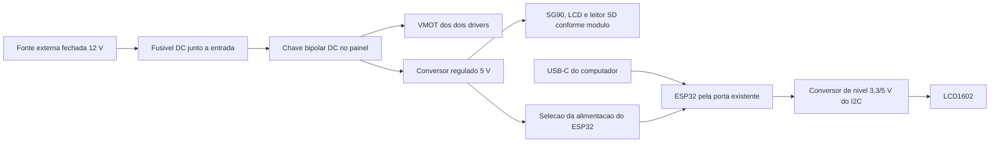

# R07 — arquitetura eletrica e interface de operacao

## Escolhas confirmadas

ESP32 existente com USB-C; dois NEMA17 e um SG90 existentes; LCD1602 com adaptador I2C existente. Arquivos por microSD, USB-C para computador. Encoder incremental EC11 com botao, nao potenciometro. Nao comprar USB host ou porta USB-B para ler pendrive.

## Alimentacao proposta

Fonte e fusivel precisam ser confirmados com corrente nominal dos NEMA17 e ajuste dos drivers. Alimentar o SG90 diretamente pelo conversor, com retorno GND dedicado; nao pelo regulador3,3 V do ESP32. Interligar GND de logica, drivers e conversor em ponto de distribuicao. Capacitores locais nos drivers e junto ao servo, fios curtos de alimentacao e fusivel adequado aos cabos.

O esquema da placa ESP32 ainda nao foi identificado. Nao unir automaticamente5 V externo e5 V USB: algumas placas nao impedem retorno de corrente. Prever jumper de selecao: em operacao por computador, desconectar alimentacao externa do pino5 V/VIN do ESP32 e alimentar a placa pelo USB; em operacao autonoma, USB desconectado e alimentacao externa ligada somente ao pino apropriado da placa. Confirmar esquema e nome do pino antes dessa ligacao. A chave12 V desliga motores/servo; o ESP32 pode continuar ligado pelo USB se o computador estiver conectado.

LCD I2C generico costuma usar pull-ups para5 V: prever conversor bidirecional para SDA/SCL, com lados3,3 e5 V separados. Nao ligar pull-up5 V diretamente a GPIO. Usar I2C lento inicialmente e cabo sinal/GND protegido. Os sensores de contato seco usam COM/NC e pull-ups externos para3,3 V. Encoder tambem trabalha com contatos para GND e pull-ups3,3 V, com debounce.

Leitor SD fica junto ao ESP32, SPI curto e alimentacao conforme o modulo comprado. O envelope usa Pololu2587; outro modulo exige conferir encaixe/niveis. Montar sem pinos retos altos: usar fios rentes ou conector90 graus para respeitar a altura sob o tampo. Usar FAT32 e testar leitura sem movimento antes de acionar motores.

## Firmware — ainda a integrar

Escolher e configurar controlador de movimento compativel com a variante exata do ESP32 e com pen-lift RC servo. Ainda faltam identificacao da placa, pinagem, corrente dos motores, teste de fim de curso, angulos reais do SG90 e integracao do menu. Nao foi entregue um firmware gravavel e validado nesta revisao. Um LCD1602 I2C com encoder nao deve ser presumido compativel com qualquer firmware CNC apenas por ter I2C.

Comportamento pretendido do menu:

1. Tela inicial com estado e arquivo selecionado.
2. Girar encoder percorre Arquivos, Referenciar, Levantar caneta, Abaixar caneta e Ajustes.
3. Clique entra/confirma; iniciar trabalho exige referencia valida, contato de limites liberado e arquivo G-code valido.
4. Pausa levanta caneta e interrompe movimento de forma controlada; cancelar exige nova referencia se a posicao for perdida.
5. Leitura SD e atualizacao do LCD devem ser desacopladas da geracao de passos. I2C bloqueado ou SD removido precisam interromper o trabalho com estado claro, sem continuar com comandos incompletos.
6. Arquivos sao trajetorias G-code geradas no computador, nao imagens JPG/PDF interpretadas diretamente pelo LCD.

## Fontes tecnicas

- Espressif USB Host: https://docs.espressif.com/projects/arduino-esp32/en/latest/api/usb_host.html
- TowerPro SG90: https://towerpro.com.tw/product/sg90-analog/
- Pololu2587: https://www.pololu.com/product/2587/specs
- TI PCF8574: https://www.ti.com/lit/ds/symlink/pcf8574.pdf
- ALPS EC11: https://tech.alpsalpine.com/assets/catalog/product-catalog-ec-all.en.pdf
- KIPP DIN705: https://www.kippusa.com/en-us/products/METRIC/Machine-and-fixture-components/Shaft-collars-locking-rings-clamp-hubs/Shaft-collars-set-screw-DIN-705-steel/p/agid.36317

Estes documentos orientam dimensoes e arquitetura. Nao substituem medir os componentes que ja estao com o usuario.
